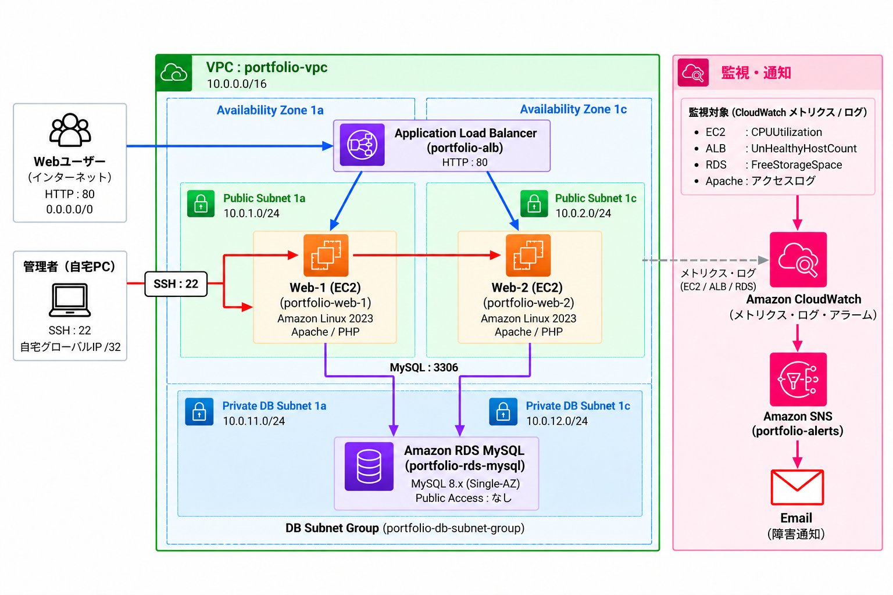

# AWS Web Infrastructure Portfolio

AWS上にALB、EC2、RDSを使用したWebインフラを構築し、
監視・障害対応・復旧まで検証したポートフォリオです。

**技術:** AWS VPC / Subnet / ALB / EC2 / RDS / Security Group / IAM / CloudWatch / SNS / Amazon Linux 2023 / Apache / PHP / MySQL

## 構成

## 実施内容

- VPC内にPublic Subnet / Private DB Subnetを2つのAvailability Zoneへ構成
- Amazon Linux 2023 EC2を2台構築し、Apache / PHPをセットアップ
- Application Load Balancerによる負荷分散とヘルスチェックを構成
- Amazon RDS for MySQLをPrivate DB Subnetに配置し、Webサーバーからの接続経路を構成
- Security GroupでALB → EC2 → RDSの必要な通信のみに制限
- EC2にIAM Roleを付与し、長期アクセスキーを配置しない構成を採用
- CloudWatchによるメトリクス監視とSNSによるメール通知を構成
- CloudWatch Agentを使用してメモリ・ディスク使用率を収集し、Apacheのアクセスログ / エラーログをCloudWatch Logsへ転送

## 運用・障害対応

- 障害試験としてCPU高負荷を発生させ、CloudWatch Alarm → SNSメール通知までの監視動作を確認
- `top` / `ps` で高負荷プロセスを特定し、プロセス停止後にCPU使用率とAlarmが正常状態へ戻ることを確認
- Apache停止試験を実施し、ALBのヘルスチェックがUnhealthyとなった際も正常なWebサーバーへ通信が継続されることを確認
- `systemctl` / `journalctl` でApacheの状態・ログを確認し、サービス復旧後にHealthyへ戻ることを確認
- RDSへのMySQL 3306通信を障害試験としてSecurity Groupで遮断し、Webサーバー・RDS本体・通信経路を切り分けたうえで復旧

障害試験の詳細は [`troubleshooting.md`](docs/troubleshooting.md) を参照。

## 成果物

- [`architecture.png`](docs/architecture.png) - AWS Webインフラ構成図
- [`design.md`](docs/design.md) - 構成・設計理由
- [`security.md`](docs/security.md) - Security Group / IAMのセキュリティ設計
- [`monitoring.md`](docs/monitoring.md) - CloudWatch / SNSの監視設計
- [`troubleshooting.md`](docs/troubleshooting.md) - 障害試験・切り分け・復旧の詳細
- [`cloudwatch-agent-web1.json`](config/cloudwatch-agent-web1.json) - Web-1 CloudWatch Agent設定
- [`cloudwatch-agent-web2.json`](config/cloudwatch-agent-web2.json) - Web-2 CloudWatch Agent設定
- [`index-web1.html`](web/index-web1.html) - Web-1確認用ページ
- [`index-web2.html`](web/index-web2.html) - Web-2確認用ページ
- [`posts.php`](web/posts.php) - RDS MySQLからデータを取得するPHPページ

## 動作確認

- ALB経由でWeb-1 / Web-2へ通信が振り分けられることを確認
- WebサーバーからRDS MySQLへの接続とデータ取得を確認
- CloudWatch AlarmからSNS経由でメール通知されることを確認
- Apache停止時に異常なWebサーバーがALBから切り離され、正常なWebサーバーへ通信が継続されることを確認
- 障害復旧後にALB / CloudWatch Alarmが正常状態へ戻ることを確認
