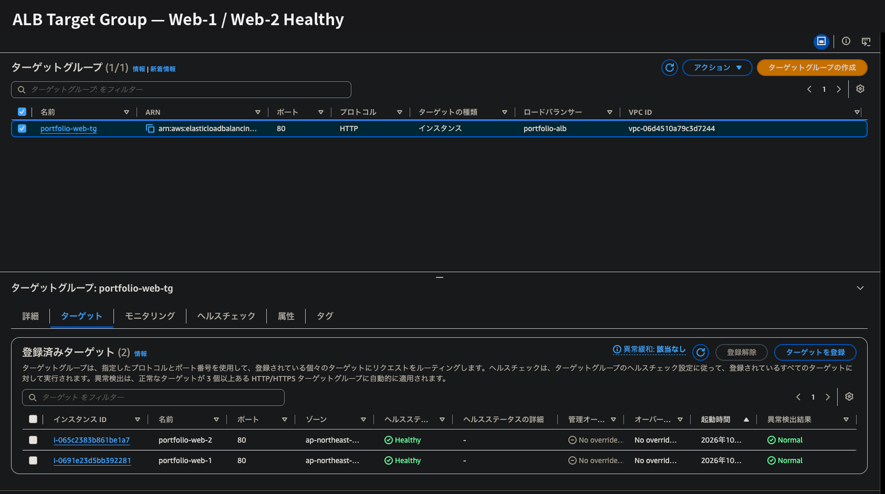
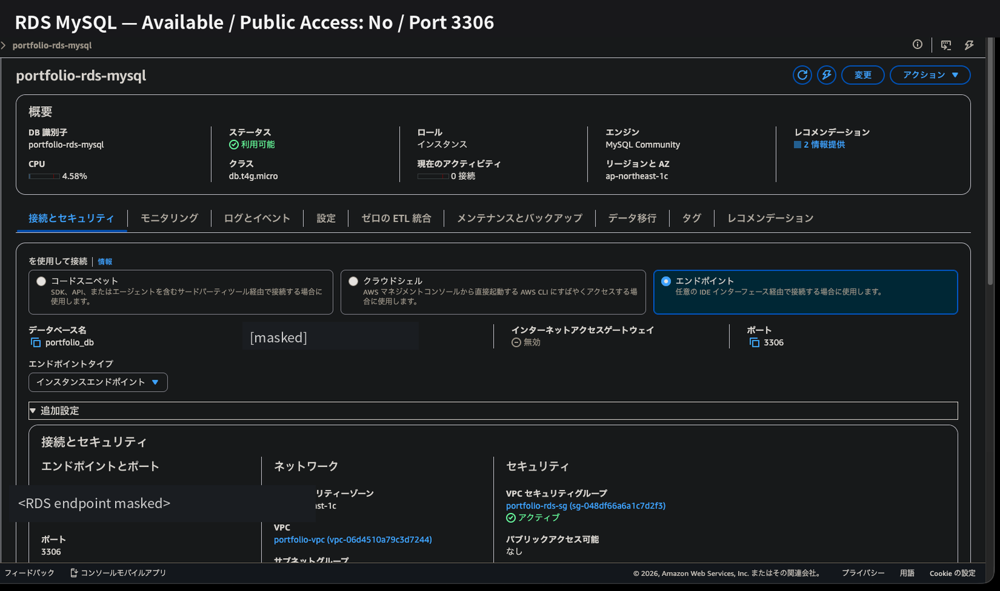

# Design

可用性・セキュリティ・コストを考慮してAWS構成を設計しました。

## 1. ALB + EC2 2台構成

Amazon Linux 2023のEC2を異なるAvailability Zoneに2台配置し、
ALBでWebアクセスを振り分けています。

ALBのヘルスチェックで異常なサーバーを切り離す構成としました。

Apache停止試験ではWeb-1がUnhealthyとなり、
Web-2で通信が継続されることを確認しました。

## 2. EC2をPublic Subnetへ配置

今回は学習・検証環境として構成をシンプルにするため、
EC2をPublic Subnetへ配置しました。

HTTPはALBからのみ、
SSHは管理端末のグローバルIP `/32` からのみ許可しています。

## 3. RDSをPrivate DB Subnetへ配置

RDS for MySQLはPrivate DB Subnetへ配置し、
Public Accessを無効化しました。

MySQL 3306はWebサーバーのSecurity Groupからのみ許可しています。

## 4. RDSはSingle-AZ構成を採用

DB Subnet Groupは2つのAvailability Zoneに構成し、
RDSはコストを考慮してSingle-AZとしました。

本番環境ではMulti-AZ構成を検討します。

## 5. IAM Roleを使用

CloudWatch Agentの権限はIAM Roleで付与し、
EC2内には長期アクセスキーを配置していません。

IMDSv2を必須としています。
