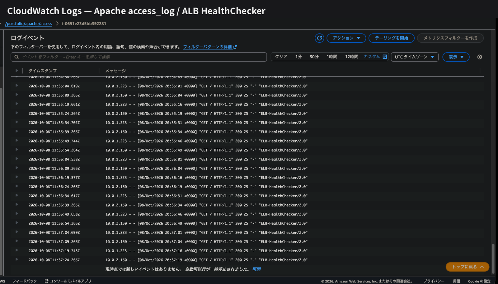

# Monitoring

このポートフォリオでは、
EC2・ALB・RDSの主要な状態をCloudWatchで監視し、
異常検知時にAmazon SNSからメール通知する構成としました。

また、CloudWatch Agentを使用して、
EC2のメモリ・ディスク使用率とApacheログを収集しています。

## 1. 監視・通知構成

```text
EC2 / ALB / RDS
      |
      v
Amazon CloudWatch
      |
      v
CloudWatch Alarm
      |
      v
Amazon SNS
      |
      v
    Email
```

## 2. 監視項目

| 対象 | メトリクス | 条件 |
|---|---|---|
| EC2 Web-1 | CPUUtilization | 80%以上 |
| ALB | UnHealthyHostCount | 1以上 |
| RDS | FreeStorageSpace | 5GiB未満 |

CloudWatch Agentでメモリ・ディスク使用率を収集し、
Apacheのアクセスログ / エラーログをCloudWatch Logsへ転送しています。



