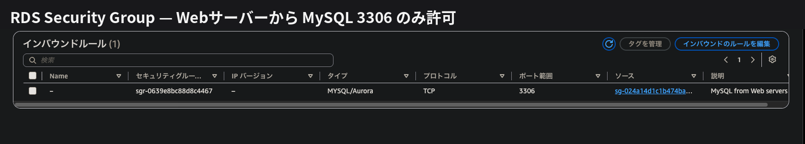
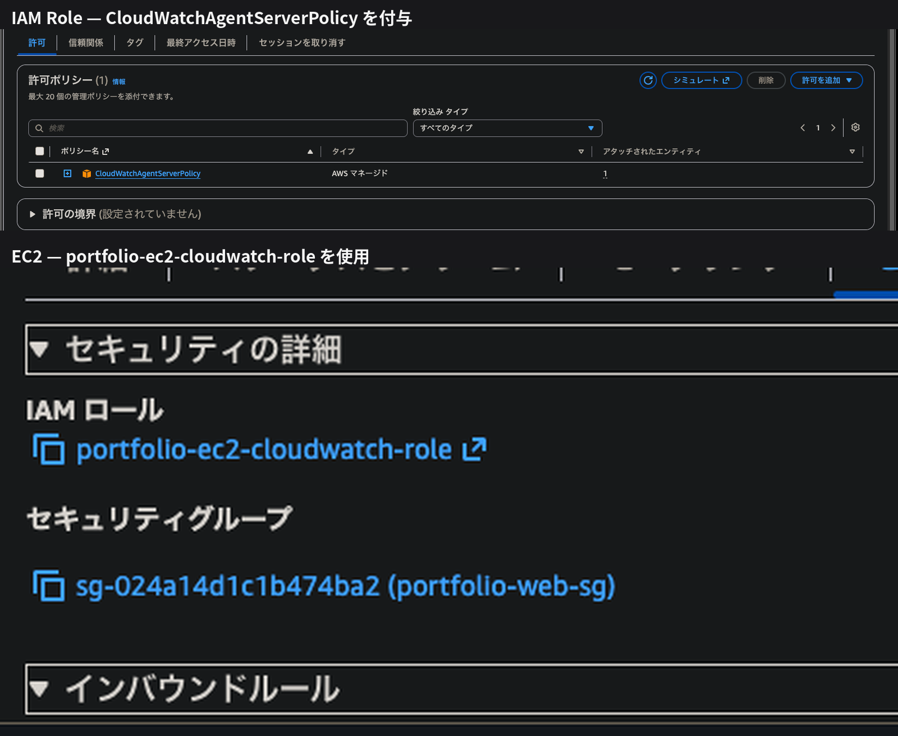

# Security

このポートフォリオでは、
外部公開する範囲を必要最小限にし、
Web・管理・データベースの通信経路ごとにアクセスを制限しました。

## 1. Security Groupによる通信制御

| 対象 | ポート | 送信元 | 用途 |
|---|---:|---|---|
| ALB | HTTP 80 | `0.0.0.0/0` | Webアクセス |
| EC2 | HTTP 80 | ALB Security Group | ALBからのWeb通信 |
| EC2 | SSH 22 | 管理端末のグローバルIP `/32` | サーバー管理 |
| RDS | MySQL 3306 | Web Security Group | WebサーバーからDB接続 |

EC2のHTTPはALBからのみ、
RDSはWebサーバーからのMySQL通信のみ許可しています。

通信経路は以下のようになります。

```text
Webユーザー
    │ HTTP : 80
    ▼
   ALB
    │ HTTP : 80
    ▼
   EC2
    │ MySQL : 3306
    ▼
   RDS
```



## 2. IAM / 認証情報

CloudWatch Agentの権限はEC2のIAM Roleで付与し、
EC2内には長期アクセスキーを配置していません。

IMDSv2を必須としています。


