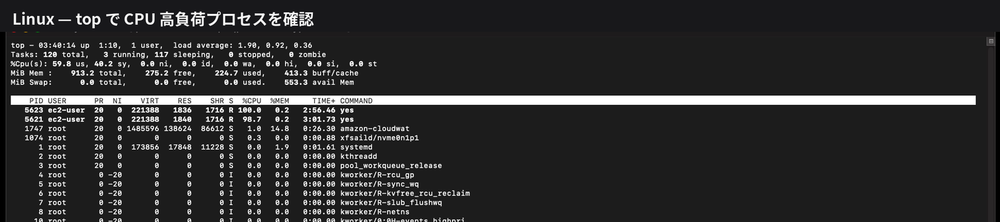
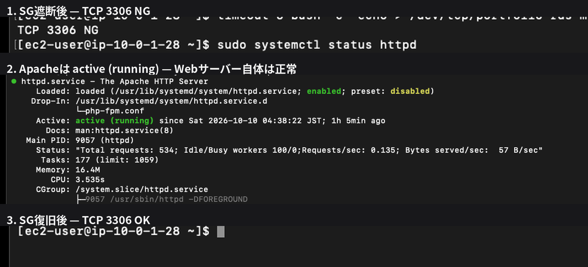

# Troubleshooting

CPU高負荷、Apache停止、RDS通信遮断の障害試験を実施し、
切り分けから復旧まで確認しました。

## 1. EC2 CPU高負荷

### 事象

Web-1にCPU高負荷を発生させ、
CloudWatch AlarmとSNS通知を確認しました。

```bash
timeout 300 yes > /dev/null &
```

### 切り分け・原因

```bash
top
ps -C yes -o pid,ppid,%cpu,%mem,cmd
```

CPUを大量に使用している`yes`プロセスを特定しました。

### 復旧

```bash
kill <PID>
```

CPU使用率が低下し、
CloudWatch Alarmが`OK`へ戻りました。



---

## 2. Apache停止

### 事象

Web-1のApacheを停止しました。

```bash
sudo systemctl stop httpd
```

Web-1が`Unhealthy`となり、
Web-2へ通信が継続されました。

### 切り分け・原因

```bash
sudo systemctl status httpd
sudo journalctl -u httpd --since "10 minutes ago"
```

Apacheが停止していることを確認しました。

### 復旧

```bash
sudo systemctl start httpd
```

Web-1が`Healthy`へ戻り、
ALBのCloudWatch Alarmも`OK`へ復旧しました。


---

## 3. RDS通信遮断

### 事象

RDS Security GroupのMySQL 3306許可を一時的に削除し、
WebサーバーからRDSへの通信を遮断しました。

```bash
timeout 5 bash -c 'echo > /dev/tcp/<RDS_ENDPOINT>/3306' \
  && echo "TCP 3306 OK" || echo "TCP 3306 NG"
```

遮断後に`TCP 3306 NG`となりました。

### 切り分け・原因

```text
Apache : active
RDS    : Available
3306   : NG
```

WebサーバーとRDS本体は正常だったため、
通信経路に原因を絞り込みました。

### 復旧

RDS Security Groupの3306許可を戻し、

```text
TCP 3306 OK
```

となることを確認しました。


